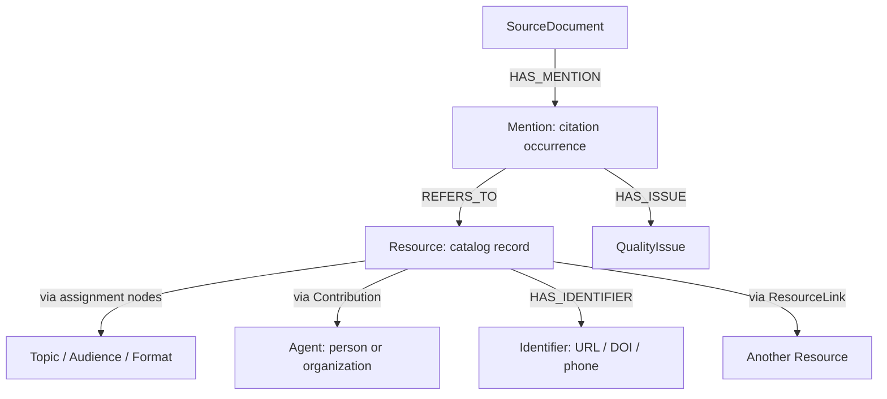
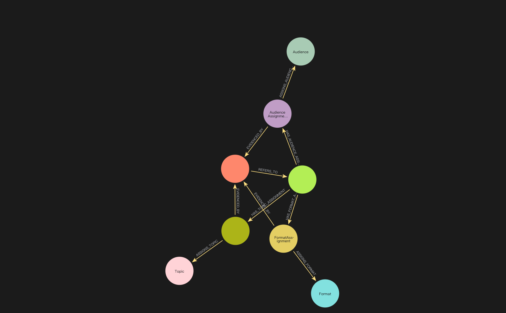
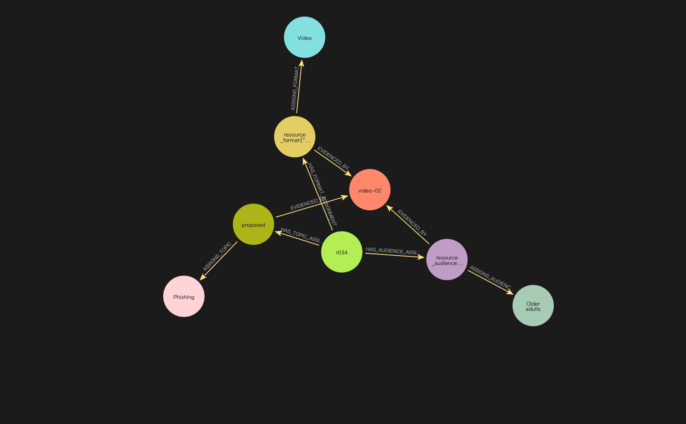
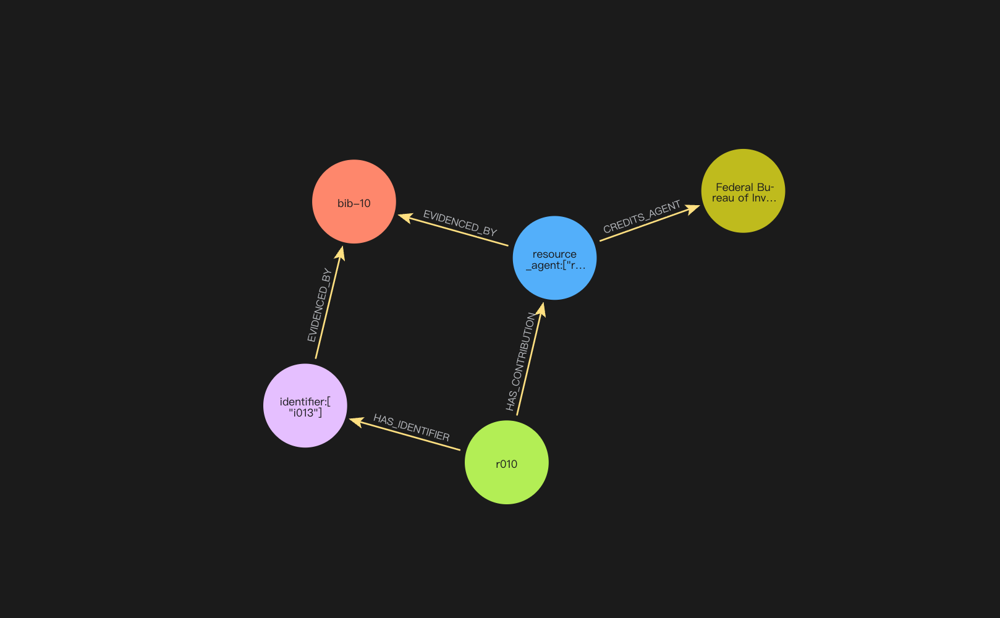
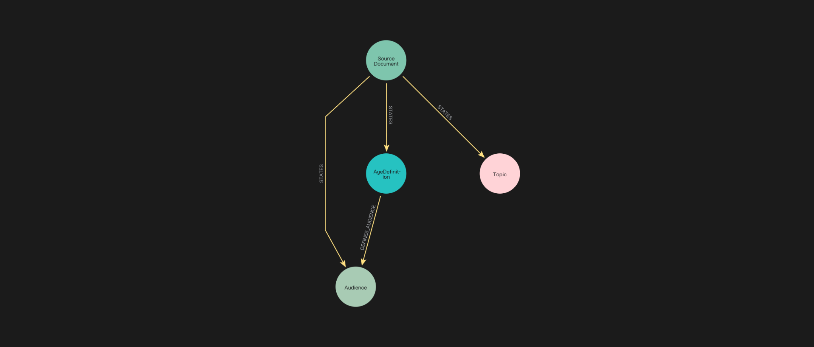
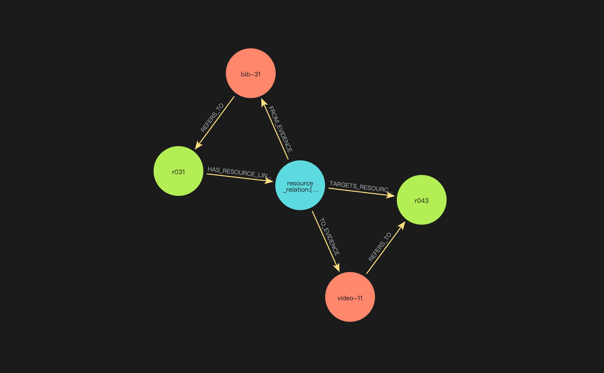

# Neo4j for an elder-fraud resource catalog

## Overall graph: what is stored?

This graph uses the same [catalog.json](data/catalog.json) as the original prototype: **49 resource records and 50 original citation occurrences** from `VPL-1_resources.pdf`. A `Resource` stores catalog metadata; a `Mention` stores a citation occurrence, its text, and page location. Assignments connect resources to shared topics, audiences, and formats while retaining the classification basis and review state.



This reading map groups related types. The full schema view has **17 node types and 27 type-to-type connections**. The five sections below unpack the paths, including import records, planning notes, and age definitions.

Every catalog node also has the technical label `CatalogRecord`, used for import keys and snapshot checks. Hiding that shared label makes the type overview easier to read. Type circles represent categories; use the linked example queries to inspect individual records and their properties. Schema visualization uses metadata statistics; the examples and verification commands check the stored paths.

**Version:** this demo runs the **v1** schema used in the meeting, with separate assignment nodes. Each section explains the proposed compact **v2 design** alongside it. V2 is documented here as a design comparison.

<details>
<summary>Run this view in Neo4j Browser</summary>

```cypher
CALL db.schema.visualization()
YIELD nodes, relationships
WITH [n IN nodes WHERE NOT 'CatalogRecord' IN labels(n)] AS nodes,
     relationships
RETURN nodes,
  [r IN relationships
   WHERE startNode(r) IN nodes AND endNode(r) IN nodes
  ] AS relationships;
```

</details>

In Browser, paste one query, click **Run**, and choose **Graph**. Drag nodes to separate branches, use **Zoom to fit**, and toggle the details panel to give the graph more space. Click a real node or arrow to inspect its properties. The figures below are Neo4j PNG exports displayed on a dark background. The embedded PNG data is unchanged.

## 1. How resources are described and classified



*Green: Resource. Orange: Mention. Olive: TopicAssignment. The other circles name the shared terms and assignment types.*

**Nodes:** `Resource` is the catalog item; `Topic`, `Audience`, and `Format` are reusable classification terms. `TopicAssignment`, `AudienceAssignment`, and `FormatAssignment` record a particular resource-to-term assignment. `Mention` supplies its citation evidence.

| Path or arrow | Meaning |
| --- | --- |
| `Resource → HAS_TOPIC_ASSIGNMENT → TopicAssignment → ASSIGNS_TOPIC → Topic` | What the resource is about. |
| `Resource → HAS_AUDIENCE_ASSIGNMENT → AudienceAssignment → ASSIGNS_AUDIENCE → Audience` | Who the resource is suggested for. |
| `Resource → HAS_FORMAT_ASSIGNMENT → FormatAssignment → ASSIGNS_FORMAT → Format` | Its format, such as video. |
| Each assignment `→ EVIDENCED_BY → Mention` | Citation used to support that assignment. |
| `Mention → REFERS_TO → Resource` | Resource identified by the citation. |

<details>
<summary>Example: r034, a phishing video tagged for older adults</summary>



*Actual records for r034: the video, its three assignments, shared terms, and citation video-02. Run the [example query](neo4j_demo/queries/01_resource_description_example.cypher) to see this view.*

</details>

For `r034`, the phishing assignment records `basis=inferred_from_citation`, `review_status=proposed`, and `source_mention_id=video-02`. Proposed assignments await catalog-maintainer review. Topic and audience assignments have review states. Format assignments currently store a basis and citation, with no review-state field.

**V2:** replace the three assignment nodes with `ABOUT`, `FOR_AUDIENCE`, and `HAS_FORMAT` relationships. Store the basis and `citation_id` on those relationships; preserve `review_status` on `ABOUT` and `FOR_AUDIENCE`. Rename `Mention` to `Citation`.

<details>
<summary>Run this view in Neo4j Browser</summary>

```cypher
CALL db.schema.visualization()
YIELD nodes, relationships
WITH [n IN nodes WHERE labels(n)[0] IN [
    'Resource',
    'TopicAssignment',
    'Topic',
    'AudienceAssignment',
    'Audience',
    'FormatAssignment',
    'Format',
    'Mention'
]] AS nodes, relationships
RETURN nodes,
  [r IN relationships
   WHERE startNode(r) IN nodes AND endNode(r) IN nodes
  ] AS relationships;
```

</details>

[Real-record example: r034](neo4j_demo/queries/01_resource_description_example.cypher) · Expected schema view: **8 type nodes, 10 arrows**.

## 2. People, organizations, and access



*Read from the green Resource node through Contribution to Agent, or through Identifier to its citation evidence. The orange node is Mention.*

**Nodes:** `Agent` identifies a person or organization. `Contribution` records their role for one `Resource`, including `contribution_role` and `credit_order`. `Identifier` stores a URL, DOI, or resource contact number. `Mention` supplies the citation evidence.

| Path or arrow | Meaning |
| --- | --- |
| `Resource → HAS_CONTRIBUTION → Contribution → CREDITS_AGENT → Agent` | Who is credited, and in what role. |
| `Contribution → EVIDENCED_BY → Mention` | Source of that credit. |
| `Resource → HAS_IDENTIFIER → Identifier` | Resource address or identifier. |
| `Identifier → EVIDENCED_BY → Mention` | Source of the identifier. |
| `Mention → REFERS_TO → Resource` | Citation-to-resource link. |

For `r010`, the FBI has the role `creator`, supported by `bib-10`. The role comes from the contribution record. A telephone identifier here is a listed resource contact number.

**V2:** use `Agent:Person` or `Agent:Organization`; replace `Contribution` with `Agent → CREATED/PUBLISHED → Resource`, carrying `credit_order` and `citation_id`. Replace `Identifier` with `Locator:Url`, `Locator:Doi`, or `Locator:Phone`. `Resource → AVAILABLE_AT → Locator` carries `identifier_id` and `citation_id`; the locator stores `value` and `kind`.

<details>
<summary>Run this view in Neo4j Browser</summary>

```cypher
CALL db.schema.visualization()
YIELD nodes, relationships
WITH [n IN nodes WHERE labels(n)[0] IN [
    'Resource',
    'Contribution',
    'Agent',
    'Identifier',
    'Mention'
]] AS nodes, relationships
RETURN nodes,
  [r IN relationships
   WHERE startNode(r) IN nodes AND endNode(r) IN nodes
  ] AS relationships;
```

</details>

[Real-record example: FBI and r010](neo4j_demo/queries/02_agents_and_access_example.cypher) · Expected schema view: **5 type nodes, 6 arrows**.

## 3. Sources, imports, and review issues


*The orange Mention points to the green Resource. The other branches preserve the import, source notes, and data issues.*

**Nodes:** `ImportBatch` records when data was imported, its snapshot hash, and source commit. `SourceDocument` stores the source file's metadata; `Mention` stores a citation occurrence; `Resource` is the normalized catalog record. `QualityIssue` records a specific data problem. `PlanningStatement` preserves collection goals or audience notes from the source document.

| Arrow | Meaning |
| --- | --- |
| `ImportBatch → IMPORTS_SOURCE → SourceDocument` | File processed by an import. |
| `SourceDocument → HAS_MENTION → Mention` | Citation occurrence in the source file. |
| `Mention → REFERS_TO → Resource` | Resource identified by the citation. |
| `Mention → HAS_ISSUE → QualityIssue` | Problem attached to that citation. |
| `SourceDocument → STATES → PlanningStatement` | Planning text preserved from the source. |

Example: `bib-08` on source page 2 identifies `r008` and has an open `missing_locator` issue. Maintainers can check the source, supply a verified locator, and update the issue. Issue states are `open`, `resolved`, or `dismissed`. They track data problems; assignment approval and resource verification are separate fields.

**V2:** `Mention → Citation`, `QualityIssue → Issue`, and `PlanningStatement → Note`. The arrows become `HAS_CITATION`, `CITES`, `FLAGGED`, and `NOTES`. The v2 display omits `ImportBatch`; retaining an import audit node is a separate implementation choice.

<details>
<summary>Run this view in Neo4j Browser</summary>

```cypher
CALL db.schema.visualization()
YIELD nodes, relationships
WITH [n IN nodes WHERE labels(n)[0] IN [
    'ImportBatch',
    'SourceDocument',
    'Mention',
    'Resource',
    'QualityIssue',
    'PlanningStatement'
]] AS nodes, relationships
RETURN nodes,
  [r IN relationships
   WHERE startNode(r) IN nodes AND endNode(r) IN nodes
  ] AS relationships;
```

</details>

[Real-record example: bib-08 and its issues](neo4j_demo/queries/03_provenance_and_review_example.cypher) · Expected schema view: **6 type nodes, 5 arrows**.

## 4. Where terms and age definitions come from



**Nodes:** `Topic` and `Audience` are reusable vocabulary terms. `SourceDocument` identifies their source. `AgeDefinition` preserves an age condition associated with an audience.

| Arrow | Meaning |
| --- | --- |
| `SourceDocument → STATES → Topic` | Provenance of a topic term. |
| `SourceDocument → STATES → Audience` | Provenance of an audience term. |
| `SourceDocument → STATES → AgeDefinition` | Provenance of an age condition. |
| `AgeDefinition → DEFINES_AUDIENCE → Audience` | Audience to which that condition refers. |

The catalog marks **20 topics** as `source_planning_vocabulary` and **5** as `curator_extension_from_citation`. The terms come from the source planning text and extensions based on citations. Import code connects the terms already present in JSON.

Four source-page-1 age records point to `older_adults`: `>=55`, `>=60`, `>=65`, and `>65`. All are `unresolved`. `minimum_age`, `comparison_operator`, and `evidence` preserve the distinct source wording for team review.

**V2:** `SourceDocument → LISTS → Topic/Audience/AgeRule`, with `source_page` on `LISTS`. Rename `AgeDefinition` to `AgeRule` and reverse the descriptive direction: `Audience → DEFINED_BY → AgeRule`. The proposed `TopicGroup` layer adds four groups and `IN_GROUP` links; it is absent from this running v1 graph.

<details>
<summary>Run this view in Neo4j Browser</summary>

```cypher
CALL db.schema.visualization()
YIELD nodes, relationships
WITH [n IN nodes WHERE labels(n)[0] IN [
    'SourceDocument',
    'Topic',
    'Audience',
    'AgeDefinition'
]] AS nodes, relationships
RETURN nodes,
  [r IN relationships
   WHERE startNode(r) IN nodes AND endNode(r) IN nodes
  ] AS relationships;
```

</details>

[Real-record example: four older-adult age definitions](neo4j_demo/queries/04_vocabulary_and_age_example.cypher) · Expected schema view: **4 type nodes, 4 arrows**.

## 5. Links between resources



This screenshot shows **real records: 5 nodes and 6 arrows**. `r031` and `r043` are separate resources. The middle `ResourceLink` is `rel001`; `bib-31` and `video-11` are the two citation records.

| Arrow | Meaning |
| --- | --- |
| `Resource A → HAS_RESOURCE_LINK → ResourceLink` | Association recorded for the starting resource. |
| `ResourceLink → TARGETS_RESOURCE → Resource B` | Other resource in the association. |
| `ResourceLink → FROM_EVIDENCE → Mention` | Citation for the starting side. |
| `ResourceLink → TO_EVIDENCE → Mention` | Citation for the target side. |
| Each `Mention → REFERS_TO → Resource` | Connect each citation to its own resource. |

`rel001` records `possible_same_work`: the catalog's stated evidence is a matching talk title and speaker with different dates and platforms. Its review state is `proposed`. The snapshot contains three possible-same-work links and one `describes_service` link, all proposed. These records already exist in JSON; the importer connects their resource and citation IDs.

**V2:** replace the middle node with `POSSIBLY_SAME_AS` or `DESCRIBES_SERVICE` between two resources. Preserve `id`, `evidence`, `review_status`, `from_citation_id`, and `to_citation_id` as relationship properties. A Resource-to-Resource arc in a type diagram can connect different resource IDs.

<details>
<summary>Run this view in Neo4j Browser</summary>

```cypher
MATCH p = (r1:Resource)-[:HAS_RESOURCE_LINK]->
  (link:ResourceLink {id: 'rel001'})-[:TARGETS_RESOURCE]->(r2:Resource)
MATCH e1 = (link)-[:FROM_EVIDENCE]->(m1:Mention)
MATCH e2 = (link)-[:TO_EVIDENCE]->(m2:Mention)
MATCH c1 = (m1)-[:REFERS_TO]->(r1)
MATCH c2 = (m2)-[:REFERS_TO]->(r2)
RETURN p, e1, e2, c1, c2;
```

</details>

[Type-level view: 3 types and 5 arrows](neo4j_demo/queries/05_resource_links_schema.cypher).

## Run the demo

Run commands from the repository root. Use Python 3.10+ and Docker Desktop for a new database. If a matching v1 demo is already running, use it directly.

```bash
python3 -m venv .venv
# macOS/Linux; on Windows use .venv\Scripts\Activate.ps1
source .venv/bin/activate
python -m pip install -r neo4j_demo/requirements.txt
python -m neo4j_version validate
```

For a **new, separate instance**, copy `neo4j_demo/.env.example` to `neo4j_demo/.env` and choose a local password before starting:

```bash
cp neo4j_demo/.env.example neo4j_demo/.env
# Edit neo4j_demo/.env, then:
docker compose --env-file neo4j_demo/.env -f neo4j_demo/compose.yaml up -d --wait
python -m neo4j_version load
```

The CLI prompts for the password. For automation, supply `NEO4J_PASSWORD` through your local environment. Open [Neo4j Browser](http://127.0.0.1:17474/browser/) and connect as `neo4j` to `neo4j://127.0.0.1:17687`. Optional CLI overrides: `NEO4J_URI`, `NEO4J_USER`, and `NEO4J_DATABASE`.

If Yuhao's demo is already running on these ports, use that instance and skip Compose startup. Existing databases retain their established password. The repository's original `elder_catalog` prototype uses different ports, **7474/7687**, and a different graph implementation.

```bash
# Print a query to copy into Browser:
python -m neo4j_version show 1
python -m neo4j_version show 5 --view example
# Verify the imported snapshot and run all checks, without writing to the database:
python -m neo4j_version verify --output neo4j_demo/validation.json
# Existing question IDs remain code lookup keys:
python -m neo4j_version query Q02
```

<details>
<summary>Validation results and data snapshot</summary>

The loader validates all 16 source arrays before import. It loads an empty target or verifies an existing matching snapshot. A different populated database is refused before schema creation. `verify` reads every source-backed node and edge, compares 14 catalog questions with an independent JSON oracle, and checks all 11 walkthrough queries. Recorded checks: **25 unit tests passed** (six original prototype native tests skipped); **14 catalog questions and 11 walkthrough queries passed** on the existing demo and a temporary fresh instance. First import, repeat import, and refusal of an unrelated populated target also passed. See [existing-demo verification](neo4j_demo/validation.json) and [fresh-import verification](neo4j_demo/validation_fresh_import.json).

The package targets snapshot SHA-256 `32d4cb61c14e276e508bf805fd1c63ac33bd8cce6397863c8410baba608c957b`, from source commit `37ebfdd0748cb0230459722430c970e1caa5a50e`. Updating source data requires registering and testing a new snapshot.

</details>

## Database choice for this catalog

MySQL remains the current preference for catalog entry, filtering, counts, and review. Neo4j makes relationships and supporting paths easier to explore. Future graph requirements should be backed by useful relationship queries. This walkthrough compares data organization and query results; database speed has not been benchmarked. See the [original prototype setup](docs/original-prototype.md) for the MySQL and SQLite commands.

## Code and references

- [Mapping and source validation](neo4j_version/model.py) · [Driver, constraints, and guarded import](neo4j_version/database.py)
- [Catalog questions and JSON oracle](neo4j_version/queries.py) · [Walkthrough verification](neo4j_version/walkthrough.py)
- [Neo4j schema visualization procedure](https://neo4j.com/docs/operations-manual/current/procedures/built-in-procedures/#procedure_db_schema_visualization)
- [Neo4j Browser graph result controls](https://neo4j.com/docs/browser-manual/current/operations/result-frames/)
