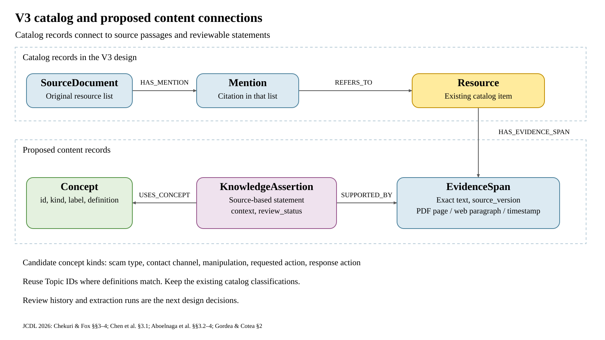

# V3 schema design for the anti-fraud resource library

Discussion outline for Yuhao and Zong-Hua, 29 October 2026.

V3 combines resource descriptions, traceable catalog evidence, and proposed content connections. The names below match the screenshots and existing queries. The catalog is implemented; the content layer is the next design step. The database remains unchanged.

## Five parts of the design

| Part | Records and relationships | Purpose |
| --- | --- | --- |
| 1 Resource descriptions | Resource through TopicAssignment, AudienceAssignment, and FormatAssignment to shared terms; each assignment EVIDENCED_BY Mention | Preserve each classification and its basis. |
| 2 People and access | Resource HAS_CONTRIBUTION Contribution CREDITS_AGENT Agent; Resource HAS_IDENTIFIER Identifier | Keep contributor roles and access information. |
| 3 Sources and review | ImportBatch IMPORTS_SOURCE SourceDocument HAS_MENTION Mention REFERS_TO Resource; Mention HAS_ISSUE QualityIssue; SourceDocument STATES PlanningStatement | Trace the catalog record and manage specific data issues. |
| 4 Vocabulary and age | SourceDocument STATES Topic, Audience, and AgeDefinition; AgeDefinition DEFINES_AUDIENCE Audience | Preserve vocabulary provenance and the original age conditions. |
| 5 Resource connections | Resource through ResourceLink to another Resource, retaining evidence for both ends; proposed content statements connect through shared concepts | Inspect recorded associations and develop content-based questions. |

The catalog contains 49 resources and 50 citation occurrences. A `Mention` is an occurrence in the original resource list. An `EvidenceSpan` will be an exact passage inside a resource, with its source version and location. These records serve different purposes.

## Questions guiding the content model

1. Which resources describe a particular scam tactic, and where is the supporting passage?
2. Which verification or support actions do those sources recommend, and in what context?
3. Where do resources discuss the same concept, and how do their populations or settings differ?

## Content records within V3

| Record | Purpose | Initial information |
| --- | --- | --- |
| Resource | Existing catalog item | Keep its ID and metadata. |
| EvidenceSpan | Exact source text | id, resource_id, source_version, verbatim_text, locator_kind, locator, alignment_status |
| KnowledgeAssertion | A statement drawn from a source | id, statement_type, statement_text, context, origin_method, review_status |
| Concept | A shared domain term | id, kind, label, definition; reuse a Topic ID where meanings match. |

| Proposed connection | Meaning |
| --- | --- |
| Resource HAS_EVIDENCE_SPAN EvidenceSpan | Locate a passage in its source resource. |
| KnowledgeAssertion SUPPORTED_BY EvidenceSpan | Retain the passage supporting the statement. |
| KnowledgeAssertion USES_CONCEPT Concept | Connect statements through a shared term, with a role such as tactic or recommended_action. |

Candidate concept kinds include scam type, contact channel, manipulation, requested action, and response action. Each statement retains its population, setting, attribution, and qualifications. Sources can share a concept while keeping their statements and evidence separate.

PDF spans need physical page(s) and a text location, web spans need a paragraph or anchor in an identifiable version, and transcript spans need a time range. Source alignment and semantic review remain separate checks.

## Preparation and review

Obtain permitted content, retain the source version, locate passages, enter statements and concepts, then inspect the supporting text. Manual entry can establish the first example.

Review responsibilities cover classification, resource verification, and suitability for older adults. Agree on reviewer, time, reason, and reversal history before adding a detailed ReviewEvent record. ContentVersion can become a separate record when several versions are retained. ExtractionRun records will be needed when machine extraction begins.

## JCDL methods informing this proposal

The methods below inform the outline. The proposed field names are project design choices.

- **P1: [Structured Knowledge Graph for Scholarly Exploration: IR and QA System for ETDs and their Elements](https://doi.org/10.1145/3805696.3846035)**, Chekuri and Fox (2026). Sections 3–4, pp. 3–6; proceedings PDF pp. 109–112. Represent internal document elements and retrieve their context.
- **P2: [From Media Records to Knowledge Graph: Interoperable Ontology Modeling for a Multimodal Martial Arts Archive](https://doi.org/10.1145/3805696.3846056)**, Chen, Hou, and Zhang (2026). Section 3.1, p. 2; proceedings PDF p. 143. Use competency questions to define concepts and relationships.
- **P3: [A Provenance-First Discovery Layer for Research Gaps, Limitations, and Future Directions in ETDs](https://doi.org/10.1145/3805696.3846045)**, Aboelnaga et al. (2026). Sections 3.2–4, pp. 3–4; proceedings PDF pp. 350–351. Keep exact source passages and locations separate from proposed interpretations.
- **P4: [HEXER: An Online Tool for Building, Validating and Exploring Knowledge Graphs from Historical Documents](https://doi.org/10.1145/3805696.3846516)**, Gordea and Cotea (2026). Sections 2.1–2.4, pp. 2–4; proceedings PDF pp. 795–797. Make review decisions inspectable and reversible. Section 2.4 stores the graph in PostgreSQL.

Article-local page numbers and file-order pages refer to the full proceedings supplied by Yuhao. The first paper evaluates a combined QA pipeline. HEXER demonstrates graph curation over PostgreSQL. Database selection remains a workload decision for this project.

## Discussion and presentation

- [Questions for Zong-Hua](schema-discussion.md)
- [Complete English walkthrough](presentation-v3.md)
- [Earlier notation and preserved files](schema-design-history.md)

MySQL remains the current preference for entry, filtering, counts, and review. The first content example will help identify whether useful path queries justify maintaining Neo4j as well.
